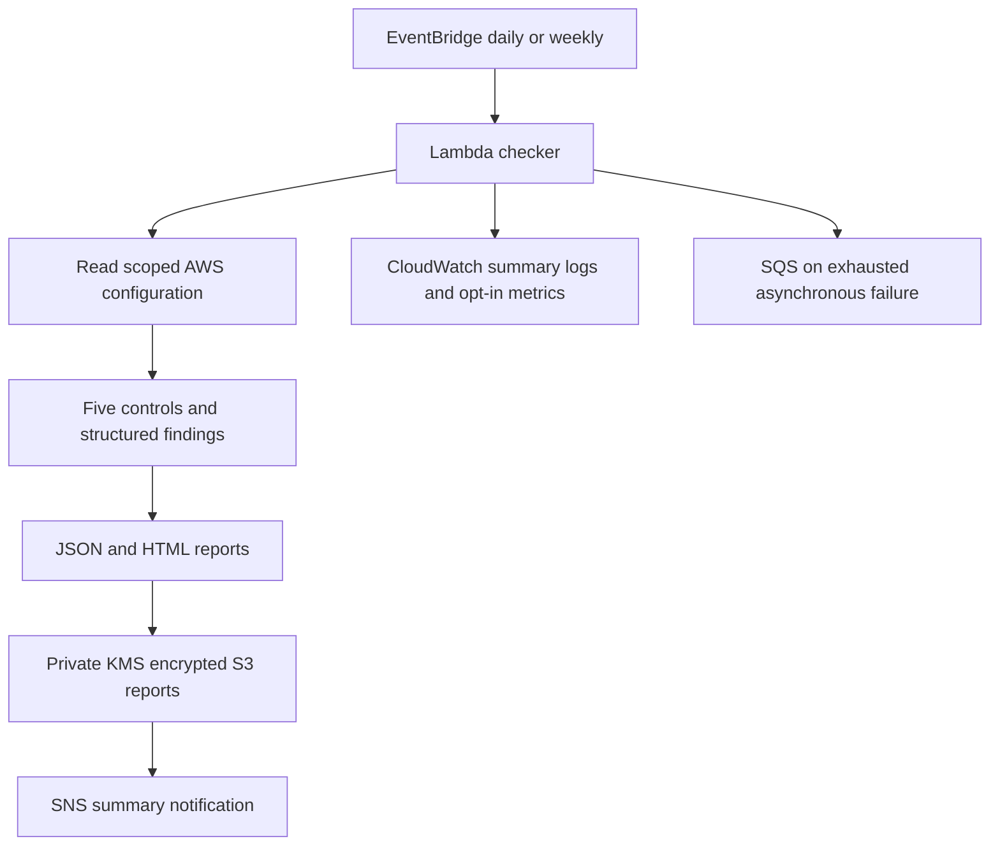

# Architecture and trust boundaries

Offline demo uses the identical scanner with boto3 clients intercepted by botocore Stubber. The AWS transport is explicitly prohibited. Test fixtures contain invented account IDs, resource names and configurations, with no patient data. The three scenarios use fixed timestamps and IDs for reproducible reports. They do not provision intentionally insecure resources.

Live entry points verify STS caller account against configured scope. Scan APIs are read-only. The CLI saves to local files and never publishes SNS or S3. Lambda reads its configuration only from environment variables: event payloads cannot change scope or enable writes. Its demo mode never passes a cloud provider to delivery, even when delivery flags are set.

Reports contain account/resource identifiers and should be restricted. SNS carries counts, run ID and an optional S3 URI only, never full findings, policies, MFA serial numbers or medical records. CloudWatch logs summary counts and delivery state only. S3 must succeed before a notification points to it. Delivery exceptions propagate so asynchronous Lambda retries and its SQS failure destination can act. EventBridge also has its own delivery retry/DLQ configured via SAM.

`finding.id` is stable across status changes (hash of control/resource/region). Each actual AWS invocation gets a separate random run ID, so retries can generate multiple reports and duplicate SNS notifications. This capstone does **not** promise exactly-once processing. Production should add EventBridge-event idempotency and alert deduplication. No automatic remediation, patient-object reads or secret retrieval are implemented.

The sample SAM stack scopes scanning to one existing bucket and its deployment region. Python accepts explicit multi-region and multi-bucket scopes. Extending SAM requires matching environment scope AND IAM resource/region permissions. CloudTrail status is read at the trail's home region, which can differ from the scanned region. Organization-owned trails can require separately authorized access; insufficient access remains UNKNOWN.

Optional monitoring emits FailedFindings, UnknownFindings and CompletedRuns only in authorized AWS mode. Metrics are sent after delivery; a metric error raises, so retries can duplicate already completed delivery. The optional dashboard and alarms have no AlarmActions and do not establish schedule liveness. Both JSON and HTML must upload before delivery reports STORED; an HTML failure can leave a partial JSON object.
